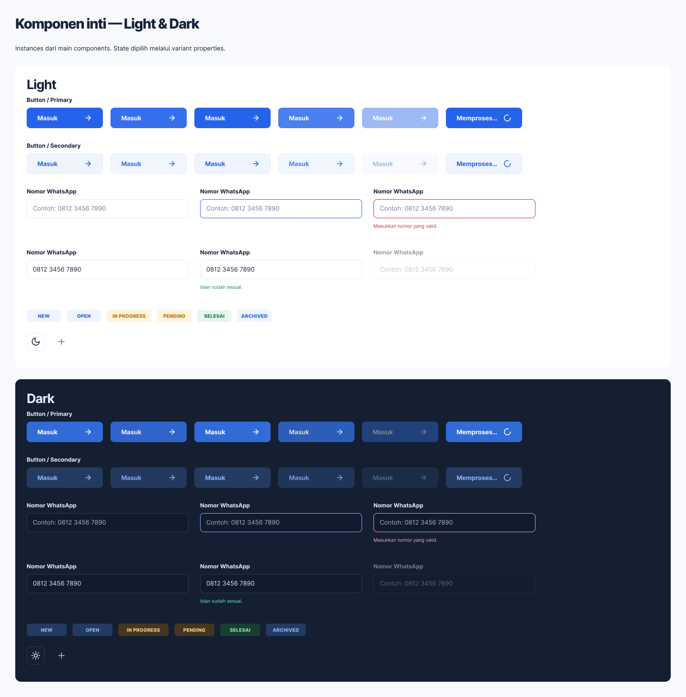

# Tahap 3 — kelanjutan melalui kursor/browser

Pengeditan langsung di editor Figma berhasil meskipun Figma MCP masih dibatasi kuota. Perubahan berikut dibuat melalui Layers, properties, rename, copy/paste native dan ekspor PNG Figma.

## Diterapkan dan diperiksa

- Empat Button Loading (Primary/Secondary × Light/Dark): binding Label/Icon dilepas khusus state Loading; label menjadi Memproses… dan instance ikon diganti loader-circle. Properties komponen lain dipertahankan.
- Empat Input Filled/Success × Light/Dark: binding placeholder dilepas dari teks nilai, sehingga nomor 0812 3456 7890 tampil. Teks tetap native dan dapat dioverride; property Filled value terpisah belum dibuat melalui UI.
- Teks pada tiga keluarga Badge Ticket/Priority/Service diratakan tengah melalui kontrol tipografi Figma.
- Helper error Periksa kembali isian Anda. ditambahkan sebagai child native pada Password, Select, Textarea dan Search, masing-masing Light/Dark. Salinan light menggunakan token DangerText light; salinan dark menggunakan token #FFABB7 dari koleksi Dark. Layer pesan memiliki tinggi 16 px dan masuk ke Auto Layout field.
- Ditemukan 32 nama varian tidak valid pada empat keluarga field hasil pemisahan sebelumnya. Seluruhnya diubah menjadi State=Default/Focus/Error/Disabled, Theme=Light/Dark. Panel properties Password telah diperiksa dan menampilkan dua sumbu yang benar. Semua baris nama yang tidak valid pada keluarga tersebut sudah diganti.

## Bukti

- Preview controls diekspor dari Figma melalui Export Review, format PNG 1×, bukan screenshot yang dimasukkan kembali ke canvas.
- Download berupa Nirwana.zip, entry Stage 3/Controls/Review.png; disalin ke screenshots/stage3-controls-cursor.png dan diperiksa secara visual.
- Preview menunjukkan empat label/ikon loading benar, nomor terisi pada empat state input, dan badge rata tengah.
- Screenshot editor: screenshots/stage3-editor-cursor.png. Tab browser dipertahankan untuk melanjutkan pengeditan.

[Buka review Figma](https://www.figma.com/design/9US6c0r5wmKyUDaWtta59T/Nirwana?node-id=351-620)

## Catatan pemulihan

- Skrip koreksi lama tidak dijalankan di Figma; perbaikan dilakukan lewat UI. Guard helper pesan pada stage-3-queued-fixes.js sudah diperbarui agar tidak menggandakan delapan pesan native yang telah ditambahkan.
- Scripter ditemukan di Community, tetapi percobaan menjalankannya mengembalikan error saat memuat plugin environment. Tidak ada script yang dijalankan melalui plugin itu.
- Browser UI tetap dapat dipakai. Pengeditan tidak memerlukan perubahan akun atau upgrade untuk tindakan native ini.

Tahap 3 masih berlangsung. Warna hover/pressed dan keluarga komponen gabungan (navigasi, kartu/tabel, pricing, modal/alert, map/import, Mode Demo dan Nira) masih perlu dikerjakan. Tahap 4 belum dimulai.
