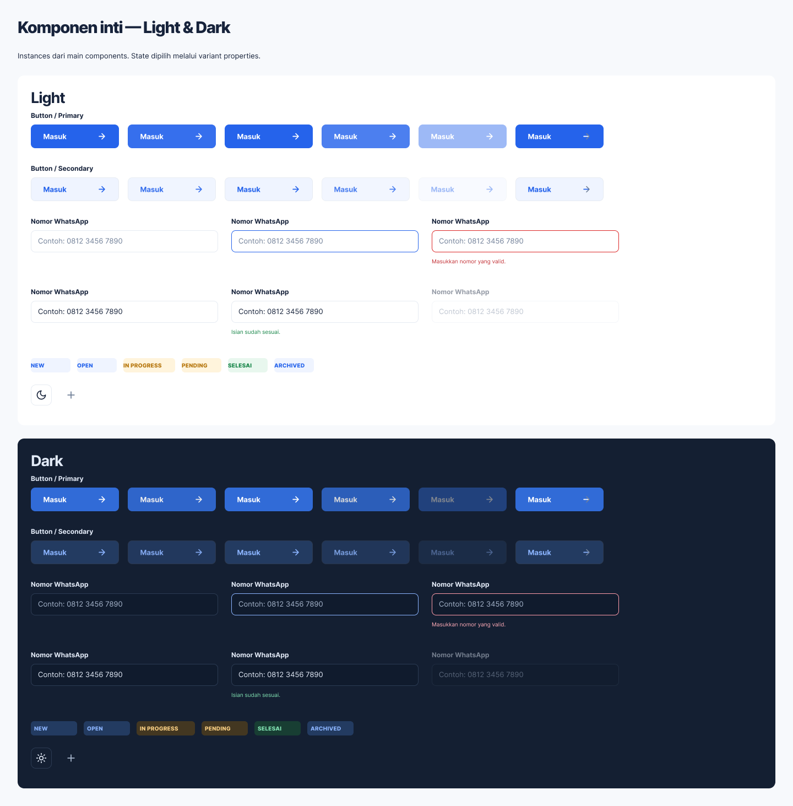

# Tahap 3 — checkpoint parsial

Status: **belum selesai; pemanggilan Figma MCP dibatasi paket Starter**. Batas dikembalikan saat mencoba mengirim koreksi setelah review; koreksi tersebut tidak diterapkan.

**Pembaruan berikutnya:** pengeditan telah dilanjutkan lewat kursor/browser. Koreksi Loading, nilai Filled/Success, alignment badge, helper error dan 32 nama varian sudah diterapkan lewat UI. Lihat [catatan kelanjutan cursor](STAGE-3-CURSOR.md). Temuan di bawah menggambarkan checkpoint sebelum kelanjutan tersebut; warna hover dan komponen gabungan masih tersisa.

## Sudah tersimpan di Figma

- 16 keluarga komponen: Brand, Button, Input, Badge Ticket/Priority/Service, Password, Select, Textarea, Search, Checkbox, Upload, Tab, Pagination, Theme Control, Icon Button.
- 31 ikon Lucide native dari dependensi web v0.468.0; ikon reusable sebagai standalone main components dan instance swap pada kontrol terkait.
- Theme Light/Dark serta state relevan default, hover, focus, pressed, disabled, loading, error, filled, success, selected sesuai keluarga. Tidak semua state berlaku pada setiap komponen.
- ID komponen lama Brand, Button, Input dan Badge dipertahankan. Konten lama disimpan dalam child Legacy tersembunyi; sebagian instances layar lama masih perlu migrasi ketika tahap layar dikerjakan.
- Form Field yang semula mempunyai 32 kombinasi sudah dipisah menjadi Password/Select/Textarea/Search, masing-masing 8 variants.
- Style Nirwana/Label/Badge 10 px Extra Bold ditambahkan.
- Review native instances dibuat pada node `351:620`, ukuran 1440×1463, di page Components & Patterns.

[Review di Figma](https://www.figma.com/design/9US6c0r5wmKyUDaWtta59T/Nirwana?node-id=351-620)

## Temuan review yang belum diperbaiki

1. Button Loading masih dapat menampilkan default label/icon Masuk/panah karena properties shared menimpa isi khusus state. Lepaskan reference Label/Icon pada Loading dan gunakan Memproses/loader.
2. Input Filled/Success masih dapat menampilkan default placeholder karena property Value shared. Gunakan property Filled value terpisah.
3. Rata tengah teks badge perlu diselaraskan dengan web.
4. Field Password/Select/Textarea/Search pada Error perlu helper error text, selain border error.
5. Hover/Pressed Button saat ini dibedakan opacity; warna hover CSS aktual masih perlu diselaraskan sebelum dinyatakan parity.

Script `stage-3-queued-fixes.js` sudah disiapkan untuk poin 1–4 dan lulus pemeriksaan sintaks JavaScript secara lokal. Script itu **belum dijalankan di Figma**. Setelah dijalankan, periksa ulang screenshot serta bounds varian yang bertambah tinggi, terutama Error fields. Poin 5 memerlukan token/paint warna hover mengikuti source CSS.

## Pekerjaan tersisa dalam Tahap 3

- Filter bar, Stat Card, Service Card, Pricing Card tujuh paket, Ticket Item, Table, Timeline dan Empty State.
- Public Header/Footer, Client Header, Ops Sidebar/Topbar, Technician Bottom Navigation dan Auth Layout.
- Mode Demo, Notification/Alert, Modal Confirmation, Map states dan Import Validation states.
- Nira launcher, panel Public/Client, bubble, prompt, composer dan typing.
- Properties/bindings/variants QA, review instances tiap keluarga, dokumentasi penggunaan.

## Bukti dan pemulihan

- `stage-3-checkpoint.json`: ID keluarga, variants, ikon, review dan pekerjaan tersisa.
- `stage-3-controls-ledger.json`, `stage-3-fields-ledger.json`: hasil tool yang sukses.
- `stage-3-controls.js`: script pembuatan awal dengan guard agar tidak menggandakan komponen.
- `stage-3-queued-fixes.js`: koreksi yang belum diterapkan.
- `lucide-icons.json` dan `extract-lucide.mjs`: sumber ikon dari paket lokal dengan lisensi ISC.

Jangan menjalankan ulang script pembuatan awal untuk melanjutkan. Baca checkpoint, inspeksi IDs terkait, jalankan koreksi tertunda, lalu lanjut keluarga yang belum ada. Tahap 4 belum dimulai. Checklist Tahap 3 tetap belum ditandai selesai.
